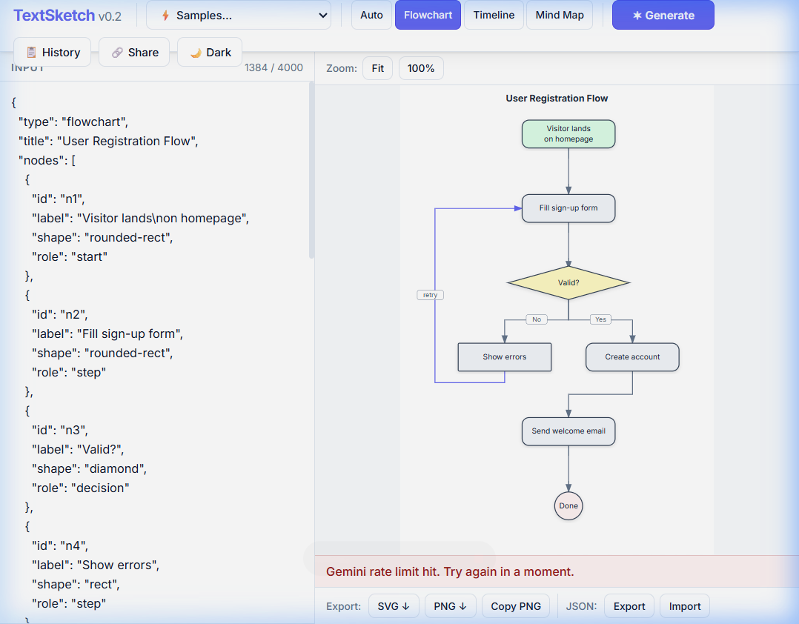
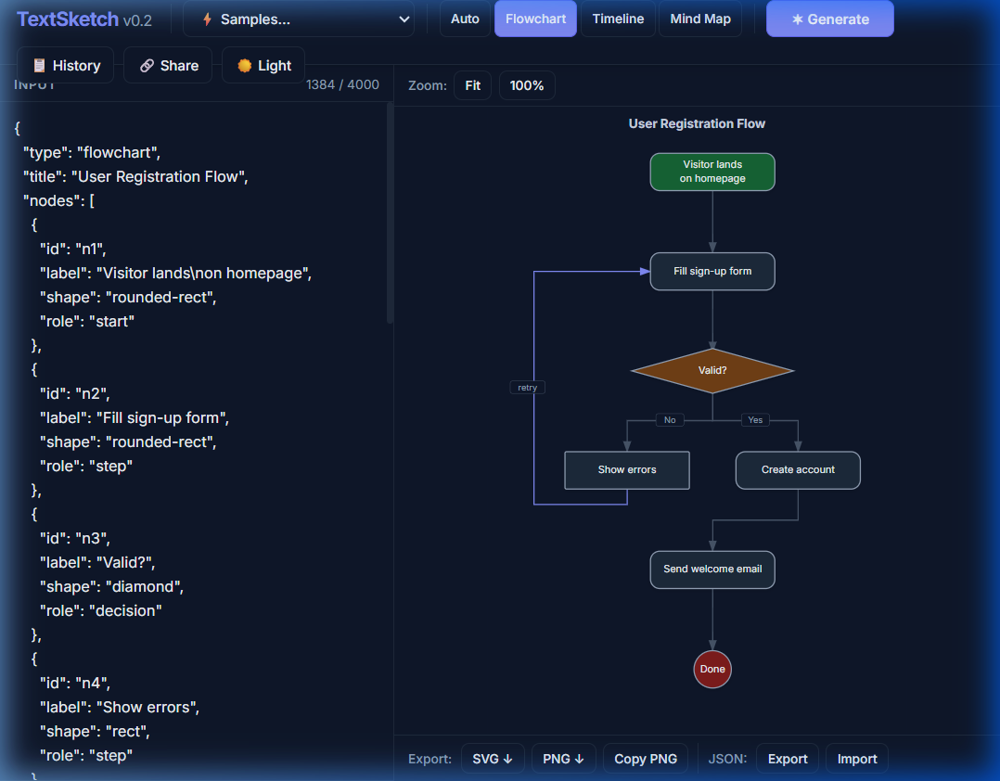
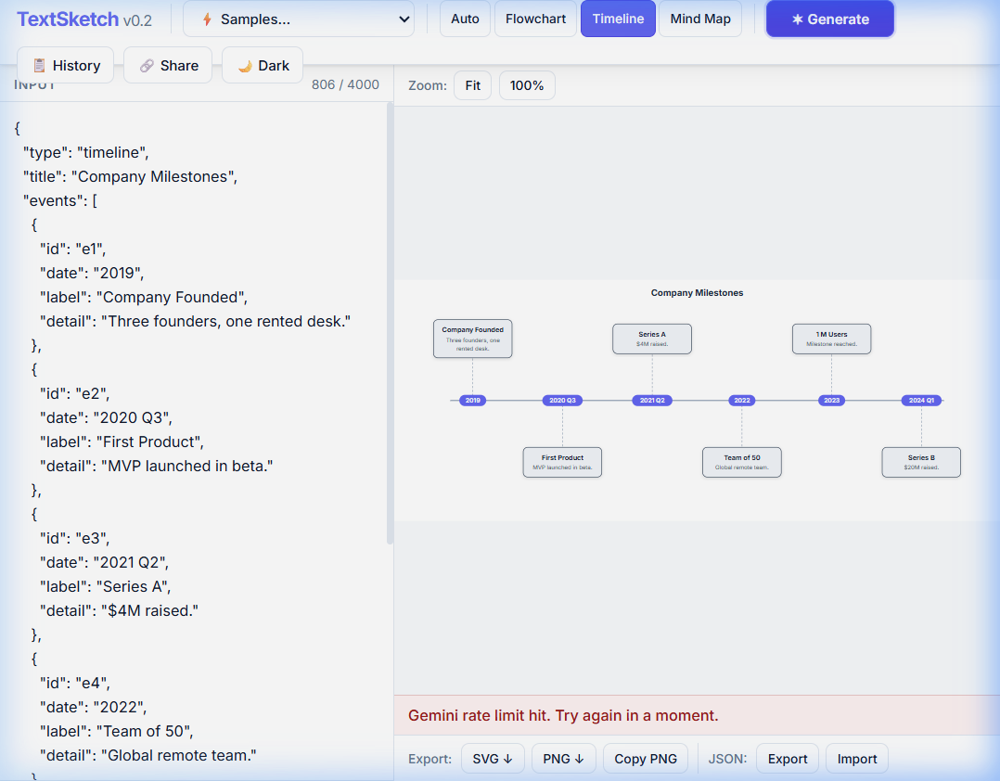
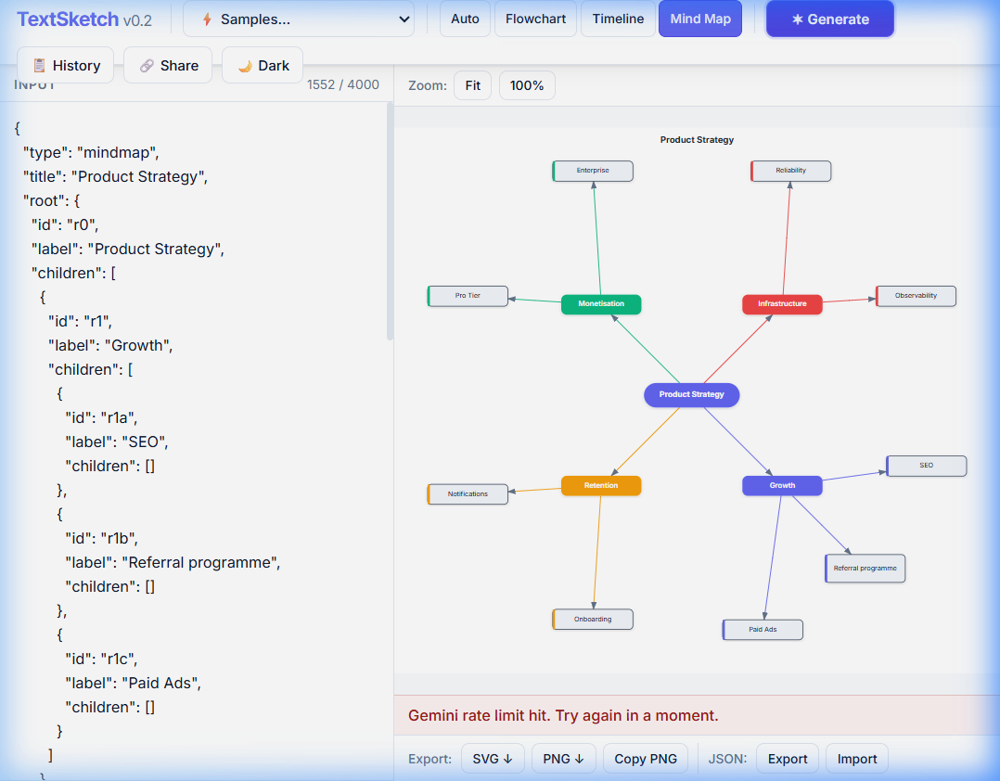
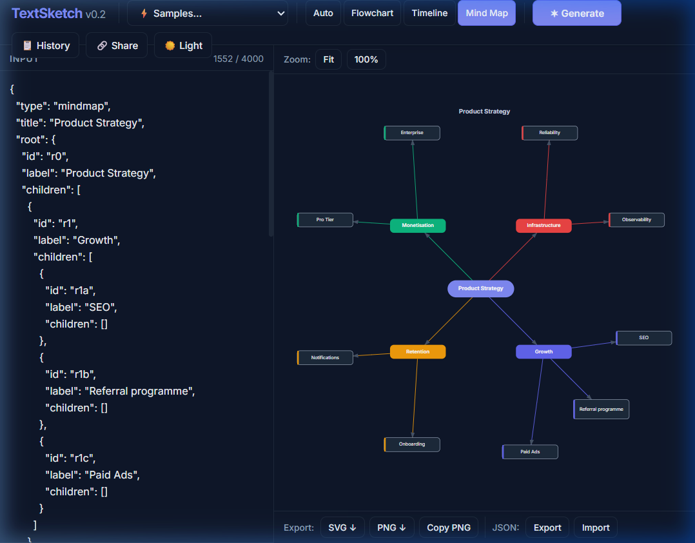
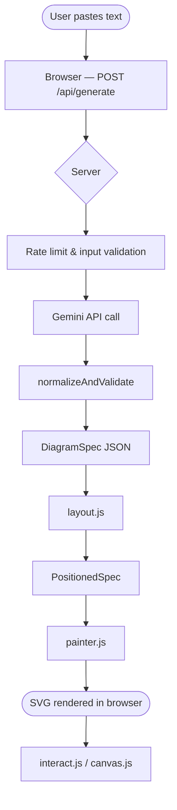

# TextSketch

**Paste any text, get an interactive SVG diagram back.**

TextSketch is a self-hosted web application. Paste a meeting note, project plan, or any prose into the left panel, choose a diagram type (or let the AI choose), and click **Generate**. The server sends the text to the Google Gemini API, which returns a structured JSON description of the diagram. The browser validates the JSON, runs a custom layout engine, and renders a clean SVG — with no external diagram library involved.

---

## Screenshots

| Flowchart — light | Flowchart — dark |
|:-----------------:|:----------------:|
|  |  |

| Timeline — light | Mind map — light | Mind map — dark |
|:----------------:|:----------------:|:---------------:|
|  |  |  |

---

## Features

- **AI generation** — paste text and click Generate; the server calls Gemini and returns a diagram.
- **Auto type detection** — in Auto mode the model reads the text and picks the most suitable diagram type.
- **Three diagram types** — flowchart, timeline, mind map; switch at any time without re-generating.
- **Drag to move nodes** — drag any flowchart or mind-map node; edges re-route live.
- **Double-click to edit labels** — click any node label to rename it in-place.
- **Zoom and pan** — scroll-wheel zoom, pinch-zoom on touch, drag-background to pan; Fit and 100% buttons.
- **Light and dark themes** — instant toggle; system preference is applied on first visit.
- **History** — the last 10 generated diagrams are stored in browser `localStorage`; open, rename, or delete entries from the History panel.
- **Share links** — encode the current diagram as a URL hash (deflate-raw compression with base64url fallback) and copy to clipboard with one click.
- **JSON import / export** — download the diagram as a `.json` file or load a previously exported file.
- **SVG export** — download the diagram as a standalone `.svg` file.
- **PNG export** — download a 2× retina-quality PNG, or copy it directly to the clipboard.
- **Autosave** — the input text, selected type, and theme are saved to `localStorage` and restored on the next visit.
- **Keyboard shortcut** — `Ctrl+Enter` (or `Cmd+Enter` on macOS) triggers Generate from anywhere in the text area.
- **Built-in samples** — several pre-built diagrams are available from the Samples dropdown without needing an API call.
- **Responsive layout** — the interface stacks vertically on viewports narrower than 800 px.

---

## How It Works

```
User types text
       │
       ▼
Browser (app.js) — POST /api/generate
       │             { text, type }
       ▼
Server (server/index.js)
  ├─ Rate-limit check (20 req / 10 min per IP)
  ├─ Input validation (max 4000 chars, valid type)
  ├─ Calls Gemini REST API with system prompt
  │    responseMimeType: application/json
  │    maxOutputTokens: 8192
  ├─ Joins non-thought response parts
  ├─ Strips any markdown fences, extracts outermost { }
  ├─ normalizeAndValidate() — fixes minor slips, throws on fatal errors
  └─ Returns DiagramSpec JSON
       │
       ▼
Browser validates DiagramSpec
       │
       ▼
layout.js — layout engine for the chosen type
  • Flowchart: layered Sugiyama-lite (cycle removal → layer assignment
               → barycenter crossing minimisation → coordinate assignment
               → edge waypoints)
  • Timeline:  horizontal swim-lane with alternating above/below labels
  • Mind map:  radial tree with per-branch accent colours
       │
       ▼
painter.js — SVG renderer
  • All elements built with document.createElementNS (no innerHTML)
  • Arrowhead markers, drop-shadow filters, gradient defs
  • viewBox auto-fits to node bounding box
       │
       ▼
interact.js — drag-to-move, double-click label editing
canvas.js   — wheel/pinch zoom, drag-background pan
```



---

## Tech Stack

| Layer | Technology |
|-------|-----------|
| Server runtime | Node.js >= 20 |
| Web framework | Express 4 |
| Environment variables | dotenv |
| AI model | Google Gemini (via REST API, `v1beta`) |
| Front-end | Vanilla ES modules — no bundler, no framework |
| Styling | Inline CSS (single HTML file) — Inter font from Google Fonts |
| Layout engines | Custom (Sugiyama-lite, swim-lane, radial tree) |
| SVG rendering | `document.createElementNS` — no SVG library |
| Test runner | `node --test` (Node.js built-in) |
| Deployment | Any Node-capable host; documented for Render |

---

## Quick Start

**Prerequisites:** Node.js >= 20 and a Gemini API key.  
Get a free key at [aistudio.google.com](https://aistudio.google.com).

```bash
# 1. Clone
git clone <repo-url>
cd textsketch

# 2. Install dependencies
npm install

# 3. Configure environment
cp .env.example .env
#    Open .env and paste your Gemini API key after GEMINI_API_KEY=

# 4. Start the server
npm start

# 5. Open in your browser
#    http://localhost:3000
```

> **Never commit `.env` to source control, and never share your API key.**  
> The `.gitignore` already excludes `.env`, but check before your first push.

---

## Configuration

The server reads these environment variables. Set them in `.env` for local development, or in your host's dashboard for production.

| Variable | Required | Default | Purpose |
|----------|----------|---------|---------|
| `GEMINI_API_KEY` | **Yes** | — | Google Gemini API key. Obtain at [aistudio.google.com](https://aistudio.google.com). Never commit this value. |
| `GEMINI_MODEL` | No | `gemini-3.5-flash` | Primary model name. The server also tries two built-in fallback models if the primary is overloaded. |
| `PORT` | No | `3000` | TCP port the server listens on. Set automatically by most hosting platforms. |
| `NODE_ENV` | No | — | Set to `production` on hosted deployments. |
| `DEBUG_AI` | No | `0` | Set to `1` to enable server-side debug logging (failure category, finish reason, output length, validation messages). Never logs user text or the API key. |

---

## Usage

### Generating a diagram

1. Paste or type text into the **Input** panel on the left (up to 4,000 characters).
2. Choose a diagram type from the toolbar, or leave it on **Auto**.
3. Click **Generate**, or press **Ctrl+Enter** (`Cmd+Enter` on macOS).
4. The spinner shows while the AI is working. The diagram appears on the right when ready.

If you paste a JSON object that starts with `{`, the app renders it immediately as a diagram without an API call.

### Switching types

Click **Flowchart**, **Timeline**, or **Mind Map** in the toolbar at any time. If you have plain text in the input, a new AI call is made. If you have a loaded diagram spec, the layout re-runs locally without a new AI call.

### Editing

- **Drag a node** to move it. Edges re-route as you drag.
- **Double-click a label** to rename it. Press Enter or click outside to confirm.

### Zoom and pan

- **Scroll wheel** to zoom in and out.
- **Pinch** to zoom on touch devices.
- **Drag the background** to pan.
- **Fit** button resets the view to show the full diagram.
- **100%** button resets zoom to 1:1.

### Exporting

| Action | Button | Notes |
|--------|--------|-------|
| Download SVG | **SVG ↓** | Standalone file with embedded background colour. |
| Download PNG | **PNG ↓** | 2× resolution for retina displays. |
| Copy PNG | **Copy PNG** | Copies to clipboard; requires HTTPS or localhost. |
| Export diagram JSON | **JSON → Export** | Downloads a `.json` file with the DiagramSpec. |
| Import diagram JSON | **JSON → Import** | Loads a previously exported `.json` file. |

### Sharing

Click **Share** to encode the current diagram into a URL hash and copy the link to your clipboard. Anyone with the link can open it directly in their browser without an account. The diagram data is stored entirely in the URL — no server-side storage is involved.

### History

Click **History** to open the recent-diagrams panel. Up to 10 diagrams are stored. Click a title to restore it, or use the rename and delete controls on each entry.

### Keyboard shortcuts

| Shortcut | Action |
|----------|--------|
| `Ctrl+Enter` / `Cmd+Enter` | Generate diagram from current text |

---

## Diagram JSON Format

The server returns — and the browser accepts via JSON import — a `DiagramSpec` object. The shape depends on the `type` field.

### Flowchart

```json
{
  "type": "flowchart",
  "title": "User Registration",
  "nodes": [
    { "id": "n1", "label": "Start", "shape": "pill", "role": "start" },
    { "id": "n2", "label": "Fill form", "shape": "rounded-rect", "role": "step" },
    { "id": "n3", "label": "Valid?", "shape": "diamond", "role": "decision" },
    { "id": "n4", "label": "Done", "shape": "circle", "role": "end" }
  ],
  "edges": [
    { "from": "n1", "to": "n2", "label": "" },
    { "from": "n2", "to": "n3", "label": "" },
    { "from": "n3", "to": "n2", "label": "No" },
    { "from": "n3", "to": "n4", "label": "Yes" }
  ]
}
```

Valid `shape` values: `rect`, `rounded-rect`, `diamond`, `circle`, `pill`.  
Valid `role` values: `start`, `end`, `step`, `decision`, `note`.

### Timeline

```json
{
  "type": "timeline",
  "title": "Project History",
  "events": [
    { "id": "e1", "date": "2023 Q1", "label": "Kickoff", "detail": "Team assembled." },
    { "id": "e2", "date": "2023 Q3", "label": "Beta launch", "detail": "100 testers." },
    { "id": "e3", "date": "2024",    "label": "v1.0 release", "detail": "" }
  ]
}
```

### Mind map

```json
{
  "type": "mindmap",
  "title": "Product Strategy",
  "root": {
    "id": "r0", "label": "Strategy",
    "children": [
      {
        "id": "r1", "label": "Growth",
        "children": [
          { "id": "r1a", "label": "SEO", "children": [] },
          { "id": "r1b", "label": "Referral", "children": [] }
        ]
      },
      { "id": "r2", "label": "Retention", "children": [] }
    ]
  }
}
```

Server-side limits (enforced and normalized before the response is sent):

| Constraint | Limit |
|-----------|-------|
| Max flowchart nodes | 40 |
| Max timeline events | 12 |
| Max mind-map depth | 3 levels |
| Max label length | 120 characters (truncated) |
| Duplicate node IDs | Made unique automatically |
| Edges to missing nodes | Dropped automatically |
| Unknown `shape` or `role` | Defaulted to `rect` / `step` |

---

## API Reference

### `POST /api/generate`

Generates a diagram from text.

**Request body** (`Content-Type: application/json`):

```json
{ "text": "string (1–4000 chars)", "type": "auto|flowchart|timeline|mindmap" }
```

**Successful response** — HTTP 200:

```json
{
  "type": "flowchart",
  "title": "...",
  "nodes": [ ... ],
  "edges": [ ... ]
}
```

**Error responses:**

| Status | Cause | `error` message |
|--------|-------|-----------------|
| 400 | `text` missing or empty | `` `text` is required and must be a non-empty string. `` |
| 400 | `text` exceeds 4000 characters | `` `text` must be at most 4000 characters. `` |
| 400 | Invalid `type` value | `` `type` must be "flowchart", "timeline", "mindmap", or "auto". `` |
| 429 | Per-IP rate limit exceeded (20 req / 10 min) | `Rate limit exceeded (20 requests / 10 min). Try again later.` |
| 429 | Gemini API rate limit hit | `Gemini rate limit hit. Try again in a moment.` |
| 502 | AI output could not be parsed as JSON after two attempts | `The AI returned malformed output after two attempts. Try again.` |
| 502 | AI output failed schema validation after two attempts | `The AI response did not match the required schema. Try again.` |
| 502 | Gemini API returned a non-200 status | `Gemini API returned HTTP <status>.` |
| 502 | Gemini returned an empty response | `Gemini returned an empty response.` |
| 503 | All fallback models overloaded | `All AI models are overloaded. Please try again in a moment.` |
| 504 | Gemini API timed out (30 s per attempt) | `AI request timed out (30 s). Try again.` |

**Limits:**
- Input: 4,000 characters maximum.
- Rate limit: 20 requests per 10-minute window, per IP address.
- Timeout: 30 seconds per model attempt; the server tries up to two attempts with a corrective prompt on failure.
- Body size: 10 KB maximum (enforced by Express).

---

### `GET /api/health`

Returns the server status. Used by hosting platforms as a liveness probe.

**Response** — HTTP 200:

```json
{ "status": "ok", "model": "gemini-3.5-flash", "keyLoaded": true }
```

---

## Project Structure

```
textsketch/
├── server/
│   └── index.js          Server — Express app, Gemini API call, rate limiting, validation
├── public/
│   ├── index.html        Single HTML shell — toolbar, split-pane layout, all CSS
│   ├── app.js            State machine, event wiring, debounce, fetch, autosave
│   ├── layout.js         Three layout engines (flowchart, timeline, mind map)
│   ├── painter.js        SVG renderer — all elements via createElementNS, no innerHTML
│   ├── interact.js       Drag-to-move nodes, double-click label editing
│   ├── canvas.js         Wheel/pinch zoom, drag-background pan, Fit / 100% buttons
│   ├── export.js         SVG download, PNG download, copy PNG to clipboard
│   ├── history.js        localStorage history — push, open, rename, delete
│   ├── share.js          URL-hash encode/decode (deflate-raw + base64url fallback)
│   ├── samples.js        Built-in sample diagrams for the Samples dropdown
│   └── themes.js         Light and dark theme token objects
├── test/
│   ├── layout.test.mjs   Layout engine tests (node overlap, back-edges, timeline, mind map)
│   └── server.test.mjs   Server tests (health, rate limiting, JSON parsing, normalization)
├── docs/
│   └── images/           Screenshots used in this README
├── .env.example          Template for required environment variables
├── .gitignore            Excludes .env, node_modules/, research/, *.bak, *.log
├── package.json          Project metadata and npm scripts
├── DEPLOY.md             Step-by-step Render deployment guide
├── PROGRESS.md           Development phase log
└── design.md             Original architecture and design document
```

---

## Testing

```bash
npm test
```

This runs `node --test test/layout.test.mjs test/server.test.mjs` using the Node.js built-in test runner (no external test framework).

**What the tests cover:**

| File | Tests |
|------|-------|
| `layout.test.mjs` | Flowchart: no node overlaps on 7-node and 21-node graphs; back-edges produce 5 waypoints. Timeline: 12 events all positioned; alternating above/below. Mind map: no overlaps on product-strategy and 6-branch samples; distinct branch colours. Share: encode → decode round-trip. Server: `normalizeAndValidate` smoke test. |
| `server.test.mjs` | `GET /api/health` returns 200. Rate limiter honours `X-Forwarded-For`. Different IPs have independent rate-limit buckets. `extractJSON`: strips fenced code blocks, extracts outermost `{…}`. `extractTextFromCandidate`: joins non-thought parts, skips thought blocks. `normalizeAndValidate`: valid spec passes; overlong labels truncated; duplicate IDs de-duplicated; dangling edges dropped; unknown shape/role defaulted; invalid type rejected. Login-flow mocked response passes. Truncated JSON fails `JSON.parse`. |

Current result: **29 tests, 29 pass, 0 fail**.

---

## Security and Privacy

### API key

The Gemini API key is stored in `.env` on the server only. It is never sent to the browser or included in any response. The startup log prints only the first 8 characters. The `DEBUG_AI` log mode never outputs the key.

### Rate limiting

The server enforces 20 requests per 10-minute window per IP address, using an in-memory token-bucket. On Render (and similar platforms) the server sets `trust proxy 1` so `X-Forwarded-For` is used for the real client IP.

### Input and output validation

- Input text is validated server-side (max 4,000 characters, valid type).
- The AI response is normalized and validated server-side before it is forwarded to the browser.
- The browser also validates the spec before rendering.
- All user-visible text is set via `.textContent`, never via `.innerHTML`, to prevent XSS.

### Security headers

The server sets `Content-Security-Policy`, `X-Content-Type-Options`, `X-Frame-Options`, and `Referrer-Policy` on every response.

### What is stored

| Location | What | When cleared |
|----------|------|-------------|
| Browser `localStorage` | Last input text, diagram type, theme, last 10 diagrams | Manually, or when the browser storage is cleared |
| Server memory | Per-IP rate-limit counters | Every 15 minutes; on server restart |
| Server disk | Nothing | — |
| Any remote server | Nothing | — |

### Third-party AI processing

The text you type is sent to the **Google Gemini API**. TextSketch does not store that text, but Google processes it according to their terms. Do not paste passwords, personal data, medical information, financial details, or any other sensitive content.

For Google's current terms and data policies for the Gemini API, see:  
[https://ai.google.dev/gemini-api/terms](https://ai.google.dev/gemini-api/terms)  
[https://policies.google.com/privacy](https://policies.google.com/privacy)

---

## Known Issues and Limitations

- **Gemini API rate limits** — the free tier has per-minute quotas. Heavy use will trigger 429 responses. Wait a moment and try again.
- **No collaborative editing** — diagrams are local to the browser that generated them (share links are the only transfer mechanism).
- **No undo within a diagram** — dragging a node or editing a label cannot be undone; to undo, restore from the History panel.
- **No diagram-to-text round-trip** — the AI output is rendered but the original prose is not reconstructed from the JSON.
- **No offline mode** — generating a diagram requires a network connection to the Gemini API.
- **In-memory rate-limit state** — resets on server restart, so a burst of requests immediately after a restart is not throttled until the first window fills.
- **`research/` directory excluded** — design research files are not in the repository.
- **`.gitignore` has duplicate `*.bak` entry** — harmless, but present.

---

## Roadmap

1. **Editable edge labels** — double-click an arrow label to rename it.
2. **Undo / redo** — track node-move and label-edit operations with Ctrl+Z support.
3. **Custom colour themes** — allow users to pick accent colours beyond the two built-in themes.
4. **Persistent share-link backend** — optional short-URL service so links do not grow with diagram size.
5. **Streaming generation** — stream the Gemini response token-by-token and show a partial diagram as it arrives.
6. **Additional diagram types** — sequence diagrams and simple Gantt charts.

---

## Deployment

See [DEPLOY.md](DEPLOY.md) for a step-by-step guide to deploying on Render. In summary: connect your repository, set `GEMINI_API_KEY` in the host's **Environment Variables** dashboard (never in source control), use `npm ci` as the build command and `npm start` as the start command, and point the health-check path at `/api/health`.

---

## Contributing

1. **Open an issue first** to discuss a change before sending a pull request.
2. Run `npm test` and make sure all 29 tests pass.
3. Never commit secrets — check that `.env` is listed in `.gitignore` before pushing.
4. Keep the server log policy: no user text in logs; API key printed only as `key (XXXXXXXX...)`.

---

## License

MIT — see [LICENSE](LICENSE).

---

## Acknowledgements

- [Google Gemini API](https://ai.google.dev) — the AI that extracts diagram structure from prose.
- The layout algorithms implemented here (layered graph drawing, radial tree layout) are based on well-known published techniques; the code is original.
- During development, the front end of the open-source [Mermaid Live Editor](https://github.com/mermaid-js/mermaid-live-editor) was studied for general UI techniques only. No code was copied. Mermaid is the trademark of its respective owners. Markmap is the trademark of its respective owners.
- Research files referenced during development are excluded from this repository.
